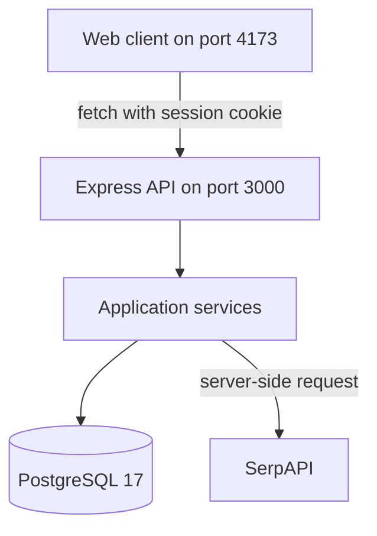
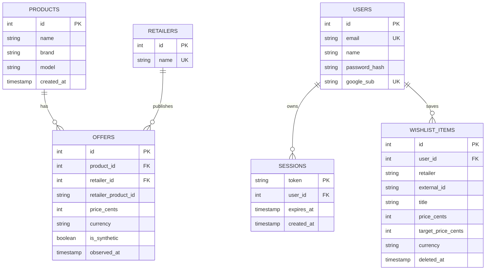

# PriceTrackers Developer and Maintenance Guide

This guide documents the `v0.9.0-beta` architecture, database, dependencies,
quality controls, and maintenance workflow. The beta is feature-frozen; changes
should be limited to verified defect fixes, documentation corrections, and
release work.

## System context

PriceTrackers has two local processes:

- A static HTML/CSS/JavaScript client served on `127.0.0.1:4173`
- An Express JSON API served on `127.0.0.1:3000`

The API owns credentials, sessions, validation, retailer integration, and all
PostgreSQL access. The browser never receives the SerpAPI key or database
credentials.

## Repository map

| Path                       | Responsibility                                                             |
| -------------------------- | -------------------------------------------------------------------------- |
| `frontend/`                | Static accessible UI, PWA manifest, and service worker                     |
| `src/server.js`            | Express composition root, CORS, probes, catalog routes, and error boundary |
| `src/Auth.js`              | Signup, login, logout, session creation, and session lookup                |
| `src/Wishlist.js`          | Authenticated wishlist CRUD and ownership enforcement                      |
| `src/LiveSearch.js`        | SerpAPI requests and retailer-response normalization                       |
| `src/ProductRepository.js` | Stored catalog and offer SQL                                               |
| `src/ComparisonService.js` | Pure stored-offer comparison logic                                         |
| `src/Database.js`          | PostgreSQL pool and parameterized query boundary                           |
| `src/Logger.js`            | Structured JSON logging and request correlation                            |
| `migrations/`              | Ordered, reversible schema changes                                         |
| `seeds/`                   | Repeatable synthetic catalog fixtures                                      |
| `tests/unit/`              | Isolated comparison and logging behavior                                   |
| `tests/integration/`       | API, authentication, wishlist, schema, and seed behavior                   |
| `tests/e2e/`               | Desktop/mobile user journeys and accessibility checks                      |
| `tests/performance/`       | k6 load and stress scenario                                                |
| `compose.*.yml`            | Isolated integration, E2E, and performance environments                    |
| `.github/workflows/ci.yml` | Five-job release verification pipeline                                     |

## Object and module design

The backend uses small modules with explicit responsibilities:

- `PriceTrackersApplication` composes middleware, routes, repositories, and
  services. A `Database` object is injected into its constructor, so tests can
  control the database lifecycle.
- `Database` encapsulates the PostgreSQL pool. Callers supply SQL text and a
  separate value array; user values are never interpolated into SQL strings.
- `ProductRepository` owns catalog queries and returns domain-shaped rows.
- `ComparisonService` is a pure class with no I/O. It validates offers and
  computes the lowest price, tied retailers, and price difference.
- `Auth`, `Wishlist`, and `LiveSearch` register cohesive route groups without
  exposing internal helpers.
- `Logger` centralizes operational log shape and request IDs.

Public classes and functions include JSDoc parameter and return descriptions.
Keep route validation near the HTTP boundary, SQL in the repository or owning
module, and deterministic calculations in pure services.

## Request lifecycle

1. `logRequest` assigns a UUID and returns it in `X-Request-ID`.
2. Express parses JSON and applies the local-origin CORS policy.
3. The route validates path, query, body, content type, authentication, and
   ownership as applicable.
4. Database values are sent through parameterized PostgreSQL queries.
5. The route returns a JSON response with a stable status and error code where
   defined.
6. The response `finish` event writes one JSON log containing timestamp, level,
   request ID, user ID, method, path, status code, and duration.
7. Unexpected failures reach the final error middleware, are logged without
   secrets, and return a generic `INTERNAL_ERROR` response.

## Database design

### Important constraints

- Prices are nonnegative integer cents and currently use `USD`.
- A stored offer is unique by retailer and retailer product ID.
- A wishlist item is unique by user, retailer, and external ID.
- Wishlist deletion is soft: `deleted_at` hides the row, and saving the same
  listing restores it.
- Sessions cascade when a user is deleted.
- `google_sub` is a reserved nullable column from an earlier design; the beta
  does not expose Google authentication.

Do not edit a migration that teammates may already have applied. Add the next
numbered migration with both `up` and `down` functions. Test rollback only
against a disposable database.

The seed is repeatable. A fresh seeded database contains three synthetic
products, two retailers, and six offers, including lower-Amazon,
lower-Walmart, and tied-price cases.

## Configuration

Create `.env` from `.env.example`.

| Variable                 | Consumer                      | Required               |
| ------------------------ | ----------------------------- | ---------------------- |
| `POSTGRES_DB`            | Docker Compose and PostgreSQL | Yes                    |
| `POSTGRES_USER`          | Docker Compose and PostgreSQL | Yes                    |
| `POSTGRES_PASSWORD`      | Docker Compose and PostgreSQL | Yes                    |
| `SERPAPI_API_KEY`        | `LiveSearch.js`               | Only for live search   |
| `PORT`                   | API process                   | No; defaults to `3000` |
| Standard `PG*` variables | `pg` pool                     | Supplied by Compose    |

The client API origin is currently fixed at `http://127.0.0.1:3000`. If ports
or deployment origins change, update the client API base, server CORS allowlist,
wishlist origin allowlist, and automated test configuration together.

## HTTP interface

### Operational probes

- `GET /health` is a liveness probe. It does not query dependencies.
- `GET /ready` executes `SELECT 1`. It returns `200` when PostgreSQL is ready
  and `503` when the dependency is unavailable.

### Stored catalog

- `GET /api/products?search=<text>` searches names, brands, and models and
  returns at most 50 rows.
- `GET /api/products/:id/offers` validates a positive 32-bit integer, returns
  the stored offers, and calculates their comparison.

### Live search

- `GET /api/live-search?q=<text>` accepts 1–80 characters.
- The server queries Amazon and Walmart concurrently through SerpAPI and
  normalizes at most eight priced results per retailer.
- Without a key, it returns `503 SEARCH_NOT_CONFIGURED` without making a paid
  request.

### Authentication

- `POST /api/auth/signup` accepts `name`, `email`, and `password`.
- `POST /api/auth/login` accepts `email` and `password`.
- `GET /api/auth/me` returns the current user or `null`.
- `POST /api/auth/logout` deletes the session and expires the cookie.

Passwords must contain at least eight characters and at most 72 UTF-8 bytes.
They are hashed with bcrypt cost 12. Sessions use 32 cryptographically random
bytes, are stored server-side, expire after seven days, and are referenced by
an `HttpOnly`, `SameSite=Lax` cookie.

### Wishlist

All wishlist routes require a current session. POST and PATCH require JSON.
State-changing requests with an `Origin` header must come from an allowed local
origin. Update and delete predicates include both item ID and user ID, so one
account cannot operate on another account's records.

## Error handling and data safety

- Expected validation failures use 4xx responses and stable error codes where
  the client needs to distinguish a condition.
- Invalid JSON returns `400 INVALID_JSON`.
- Unknown endpoints return `404 NOT_FOUND`.
- Unexpected errors return a generic message; internal error details are kept
  in structured logs.
- External links accept only HTTP or HTTPS and reject embedded credentials.
- Frontend-generated markup escapes untrusted text and validates external URLs.

See [SECURITY.md](SECURITY.md) for controls, limitations, and release checks.

## Testing strategy

| Layer         | Tool                          | Release coverage                                                                           |
| ------------- | ----------------------------- | ------------------------------------------------------------------------------------------ |
| Unit          | Node test runner              | Comparison edge cases and JSON logger fields                                               |
| Integration   | Node test runner + PostgreSQL | Probes, catalog, auth, sessions, wishlist CRUD/ownership, migrations, and repeatable seeds |
| E2E           | Playwright                    | Search, basket, account, database wishlist, desktop, and mobile journeys                   |
| Accessibility | Axe + Playwright              | WCAG 2.1 A/AA scans, keyboard operation, names, dialogs, and landmarks                     |
| Performance   | k6                            | Health, readiness, and stored search under ramping 5–20 VUs                                |
| Supply chain  | npm audit + Gitleaks          | Dependency advisories and committed secrets                                                |

E2E tests route live-search requests to deterministic fixtures. They must not
consume SerpAPI credits. Integration tests explicitly blank the key for the
same reason.

### Coverage and performance gates

- Integration CI requires at least 60% line, branch, and function coverage.
- k6 requires check rate above 99%, failed-request rate below 1%, and p95 HTTP
  duration below 500 ms.
- Playwright runs the same five scenarios in desktop and mobile Chromium.
- Axe scans use `wcag2a`, `wcag2aa`, `wcag21a`, and `wcag21aa` tags.

The README contains copy-ready local commands. CI uploads quality,
integration, secret-scan, Playwright, accessibility, and performance evidence
for 30 days.

## Operational logging

Every completed HTTP request writes one JSON object. Required fields are:

- `timestamp`
- `level`
- `message`
- `request_id`
- `user_id`
- `method`
- `path`
- `status_code`
- `duration_ms`

Application errors add `error_message`. Never add passwords, session tokens,
API keys, full cookie headers, or request bodies to logs. A request ID is also
returned in `X-Request-ID` for support correlation.

## Third-party dependencies

| Dependency        | Role                                   | Maintenance note                                                              |
| ----------------- | -------------------------------------- | ----------------------------------------------------------------------------- |
| Express           | HTTP routing and middleware            | Retest error middleware and JSON parsing after upgrades                       |
| PostgreSQL / `pg` | Persistent data and pooled connections | Apply supported database updates and test migrations                          |
| Knex              | Migration and seed runner              | Schema queries otherwise use parameterized `pg` SQL                           |
| bcrypt            | Password hashing                       | Native install scripts must be reviewed and allowed in the chosen environment |
| SerpAPI           | Amazon/Walmart search provider         | Keep the key server-side; monitor quotas and response-shape changes           |
| Playwright        | Desktop/mobile browser automation      | Keep container and npm package versions aligned                               |
| Axe               | Automated accessibility audit          | Supplement with manual assistive-technology review                            |
| k6                | Load and stress testing                | Rebaseline thresholds only with documented evidence                           |

Run `npm audit --audit-level=low` and the complete CI pipeline after dependency
changes. Do not use `npm audit fix --force` without reviewing breaking changes.

## Maintenance workflow

1. Create or update a GitHub Issue with expected behavior, severity, and
   acceptance criteria.
2. Branch from the current release branch.
3. Make the smallest cohesive change and update tests, JSDoc, and documentation.
4. Run the relevant local suite, then the complete CI pipeline.
5. Link logs, screenshots, or artifacts in the issue.
6. Obtain peer review and close the issue only after verification.

For a database change, additionally test `migrate:latest`, repeatable seeds,
and rollback on an isolated database. For a frontend asset change, increment
the cache name in `frontend/sw.js` so installed clients receive the new files.

## Release process

1. Confirm the working tree is clean and the branch is synchronized.
2. Confirm all tracked findings have a documented resolution or accepted beta
   limitation.
3. Run all five CI jobs and preserve their artifacts.
4. Complete the [Team Lead Audit](TEAM_LEAD_AUDIT.md).
5. Verify `package.json`, `package-lock.json`, `CHANGELOG.md`, and the service
   worker cache identify the intended release.
6. Create the annotated tag only after the final documentation commit.
7. Push the tag and create the GitHub Release with test evidence and known
   limitations.

Do not include `.env`, `node_modules`, local database data, Playwright working
directories, or nested ZIP files in a release archive.

## Future work after feature freeze

- Password recovery with expiring single-use tokens
- OAuth only after provider credentials, callback validation, and account-link
  behavior are designed and tested
- Secure production cookies, HTTPS, rate limiting, and CSRF defense review
- Automated target-price notifications and price history
- Product identity matching across retailer listings
- Deployment configuration instead of hard-coded local origins
- Manual screen-reader testing and broader browser coverage
